# Pantry Flow (My Pantry Pal)

A mobile pantry-management and meal-planning app that helps people use the food they already have. It tracks what is in your pantry, recommends recipes from those items with Google's Gemini API, and connects missing ingredients to a shopping list.

Pantry Flow started as a team project for a UX design course. We took it from user research and scenario design, through wireframes and a Figma prototype, to a working Flutter app.

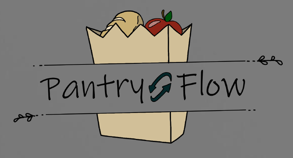

**Team:** Mihir Karnani, Gabriel Scarpati, Joshua Vrana

**Figma prototype:** [View the design](https://www.figma.com/design/chzLQSKX2ESotvlmTQMOa8/PantryFlow?node-id=0-1&p=f)

## The problem

- People forget what food they already have at home.
- It is hard to decide what to cook from the ingredients on hand.
- Shopping without a clear picture of the pantry leads to duplicate purchases and wasted food.
- Busy people need a fast, low-effort way to plan meals.

## Who it is for

We designed for home cooks and families trying to reduce food waste, busy people who need quick meal ideas, health-conscious users who want to see what they are eating, and beginner to intermediate cooks looking for inspiration.

## Features

- **Pantry tracking:** keep a live list of what you have at home, which is useful when you are in the store and cannot remember if you already own something.
- **AI-recommended recipes:** recipes suggested from the items currently in your pantry, using the Gemini API.
- **Shopping list:** build a shopping list in the app, add missing recipe ingredients to it, and move items into the pantry after shopping.
- **Accounts:** login and registration screens.

Full nutrition tracking was designed but not included in the first version because of time and complexity. It is planned for future work.

## Design process

### 1. Personas

We wrote four personas, each with goals and pain points: a busy parent, a health-conscious young professional, a college student on a budget, and an elderly home cook.

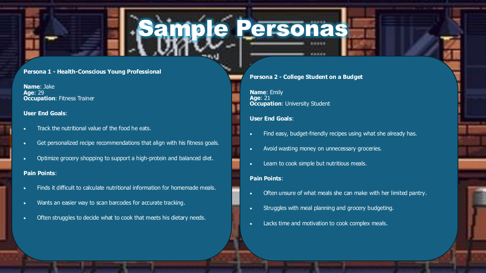

### 2. Scenarios

We mapped two scenarios frame by frame, recording what the user does, how they feel, and what they need at each step. Each scenario includes a moment where the user changes approach, and one where they are interrupted or give up.

- **Busy professional planning meals on a short break.** Surfaced needs: filtering recipes to only the ingredients she has, autosave when she is interrupted, and a grocery list organized for faster shopping.
- **Parent trying to reduce food waste.** Surfaced needs: barcode scanning, manual entry for items without barcodes, expiration tracking, meal suggestions from ingredients that are about to expire, and a simpler way to connect to grocery accounts.

### 3. Wireframes and storyboard

The user flow maps how someone moves between the menu, adding items (by barcode or search), viewing the pantry, browsing recipes, and the shopping list.

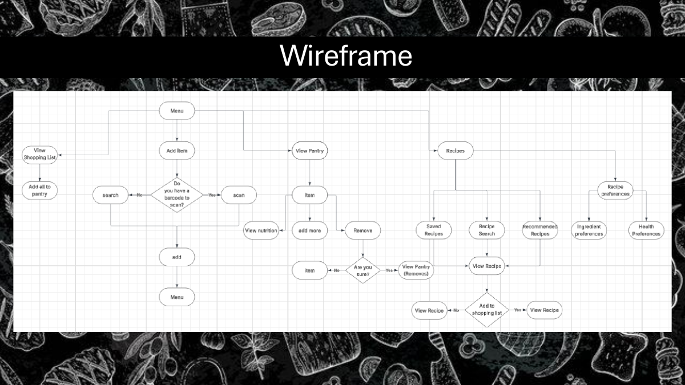

We also sketched low-fidelity screens by hand before moving to Figma.

| Login | Pantry home | Recipe details | Scan barcode |
| --- | --- | --- | --- |
| 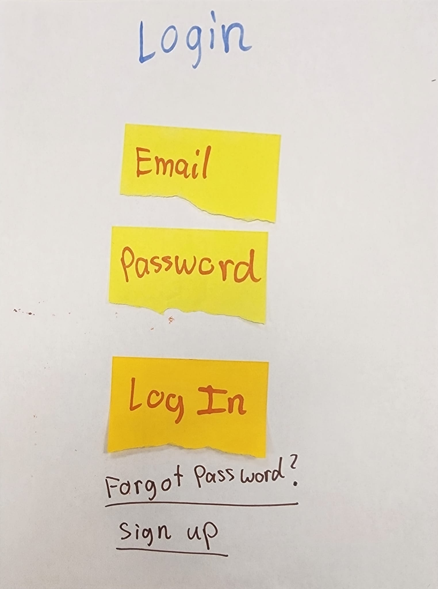 | 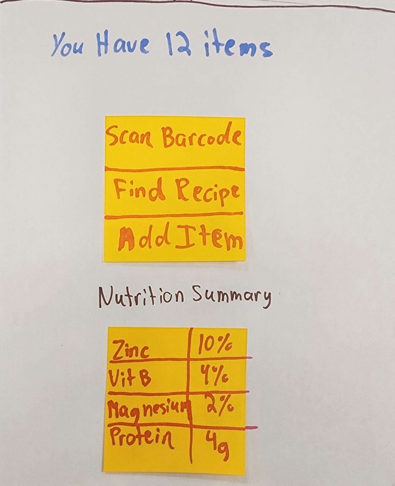 | 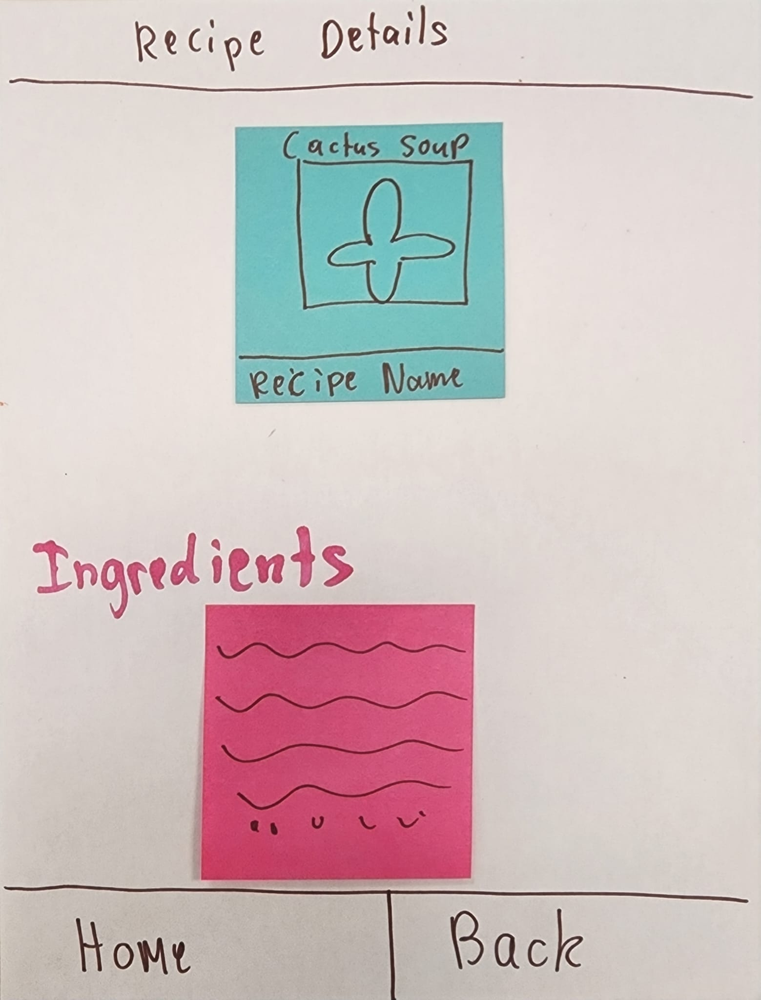 | 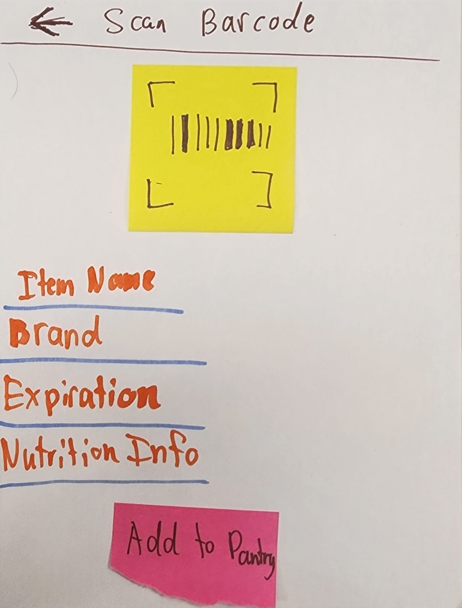 |

A storyboard followed one user from "I have no idea what I can cook with this" to choosing a recipe and adding missing items to a shopping list.

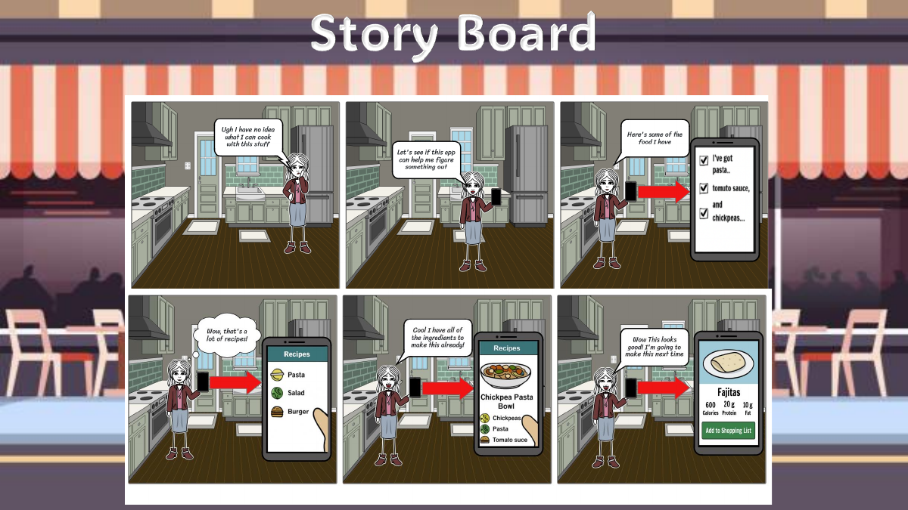

### 4. Figma prototype and user feedback

We built the interface in Figma and asked people for feedback on whether the design matched their needs, how easy it was to navigate, whether features were missing, and whether the AI-recommended recipes were useful.

Feedback asked for:

- nutritional information such as carbs, protein, and fats
- more detailed ingredient measurements (oz, lbs, and so on)
- a navigation bar to make the app easier to use
- user-uploaded recipes

Final design screens from the Figma prototype:

| Get started | Home | My Pantry |
| --- | --- | --- |
| 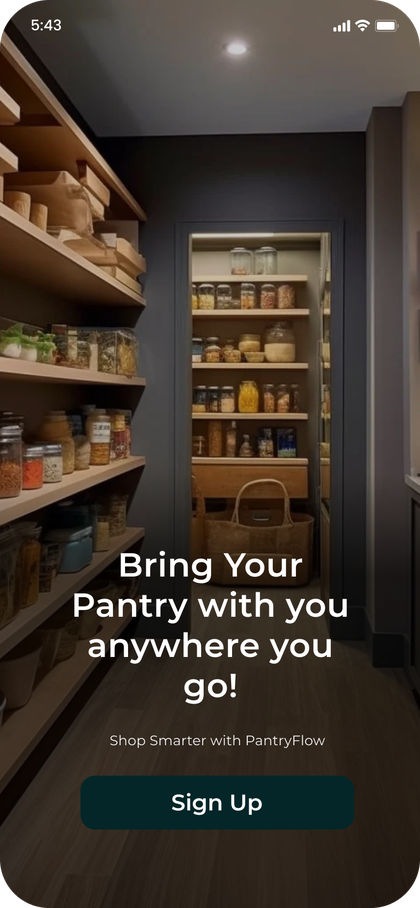 | 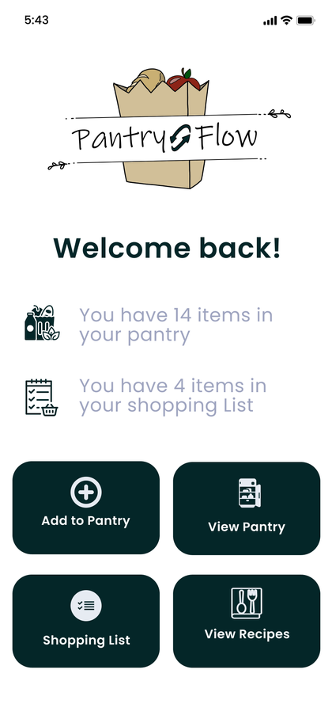 | 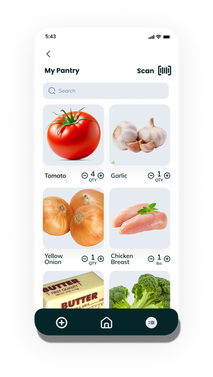 |

| Recommended recipes | Saved recipes | Shopping list |
| --- | --- | --- |
| 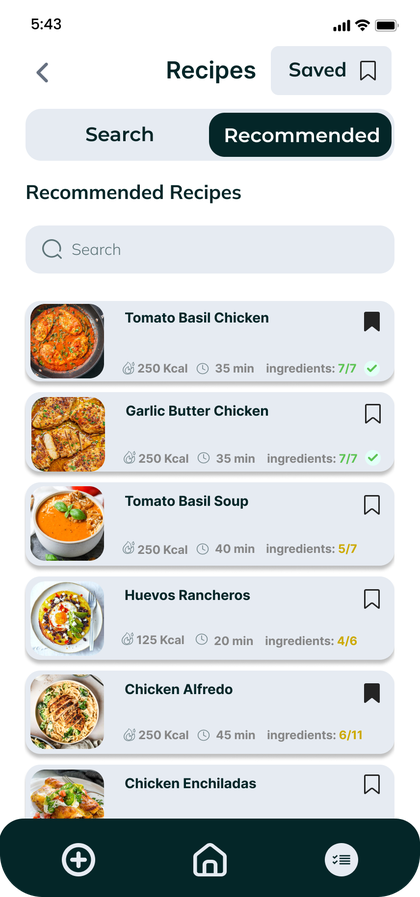 | 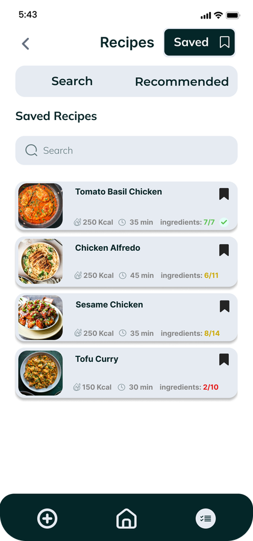 | 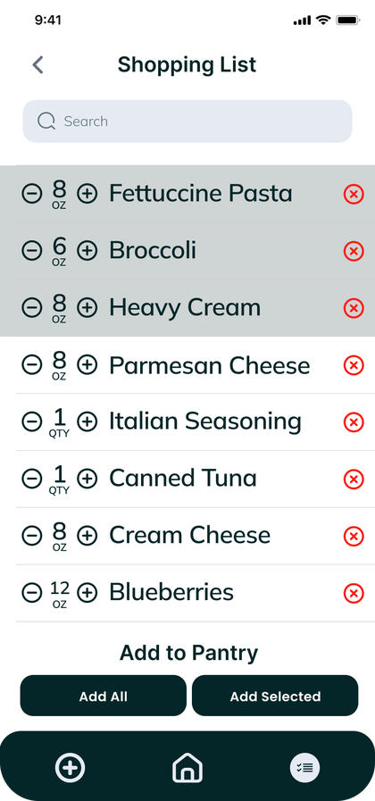 |

The home screen shows how many items are in the pantry and on the shopping list. The recipe screens show calories, cook time, and how many of a recipe's ingredients the user already has. On the shopping list, items can be added to the pantry all at once or one at a time.

### 5. Flutter app

We then built the app in Flutter with Gemini-powered recipe recommendations.

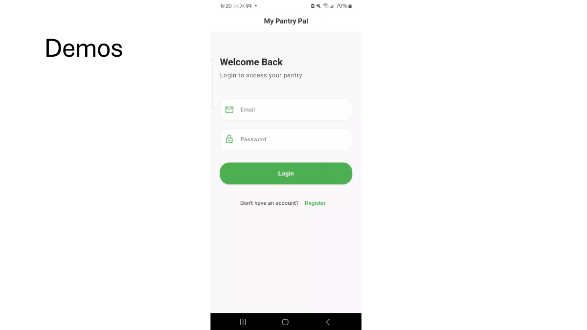

## Built with

- Figma for personas, flows, wireframes, and the prototype
- Flutter and Dart
- Google Gemini API

## Challenges and what we learned

- **Design to development gaps:** some Figma designs were difficult to match exactly in Flutter, so we simplified layouts and interactions.
- **Feature selection:** deciding which features mattered most for the first version.
- **Scope:** keeping the app simple while planning for more advanced AI features, which is why full nutrition tracking was left for later.
- **Technical execution:** both the Figma and Flutter work took longer than expected.

The main lesson was that a design that works in a prototype can look different once you account for real technical constraints, and that scope and usability decisions matter as much as visual design.
